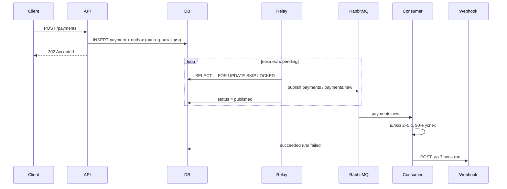

# Асинхронный сервис процессинга платежей

Сервис принимает запрос на оплату, сразу отвечает `202 Accepted` и проводит платёж в фоне. Результат уходит клиенту на `webhook_url`.

API не публикует сообщения в брокер само. В одной транзакции с платежом пишется строка в `outbox`, а отдельный relay в процессе consumer доставляет её в RabbitMQ. Если RabbitMQ недоступен в момент создания платежа, платёж всё равно сохранён и будет опубликован после восстановления брокера.

## Стек

FastAPI, Pydantic v2, SQLAlchemy 2.0 (async), PostgreSQL, RabbitMQ, FastStream, Alembic, Docker Compose.

## Запуск

Нужны Docker и Docker Compose.

```bash
docker compose up --build
```

Поднимутся четыре сервиса:

| Сервис | Назначение | Порт |
| --- | --- | --- |
| `postgres` | платежи и outbox | 5432 |
| `rabbitmq` | очередь и management UI | 5672, 15672 |
| `api` | HTTP API | 8000 |
| `consumer` | outbox relay и обработчик `payments.new` | — |

Миграции применяются при старте `api` и `consumer` под advisory lock, так что гонка на пустой базе безопасна.

RabbitMQ UI: http://localhost:15672, логин `payments`, пароль `payments`. Пользователь `guest` из контейнера не подключается: у него доступ только с localhost.

Документация API: http://localhost:8000/docs. Заголовок `X-API-Key` нужен для `/api/*`. `/health`, `/ready` и `/docs` открыты.

Ключ по умолчанию: `dev-api-key`. Для своего значения:

```bash
API_KEY=dev-api-key docker compose up --build
```

Остановить и удалить данные:

```bash
docker compose down -v
```

`-v` нужен, если менялись аргументы очередей (TTL, DLX). Иначе RabbitMQ ответит `PRECONDITION_FAILED` на уже существующую очередь.

### Локально без Docker

Нужны PostgreSQL и RabbitMQ. Пользователь брокера в этом случае может быть стандартным `guest`.

```bash
python -m venv .venv
source .venv/bin/activate
pip install -r requirements.txt
cp .env.example .env
alembic upgrade head
uvicorn app.main:app --reload
python -m app.consumer
```

## API

### Создать платёж

`POST /api/v1/payments`

Заголовки: `X-API-Key`, `Idempotency-Key` (обязательный, до 255 символов).

```bash
curl -sS -D - -X POST http://localhost:8000/api/v1/payments \
  -H "Content-Type: application/json" \
  -H "X-API-Key: dev-api-key" \
  -H "Idempotency-Key: order-1001" \
  -d '{
    "amount": "1500.50",
    "currency": "RUB",
    "description": "Order 1001",
    "metadata": {"order_id": "1001"},
    "webhook_url": "http://host.docker.internal:9000/webhook"
  }'
```

Ответ `202 Accepted`:

```json
{
  "payment_id": "3fa85f64-5717-4562-b3fc-2c963f66afa6",
  "status": "pending",
  "created_at": "2026-10-29T12:00:00+00:00"
}
```

`amount` лучше передавать строкой: так не теряется точность. Допустимы валюты `RUB`, `USD`, `EUR`. Сумма больше нуля и не больше двух знаков после запятой.

`webhook_url` должен быть доступен из контейнера `consumer`. Для приёмника на хосте в compose добавлен `host.docker.internal`. Запустить приёмник:

```bash
python3 scripts/webhook_receiver.py webhook-events.jsonl 9000
```

Каждый POST он пишет отдельной строкой в файл и отвечает `204`.

### Получить платёж

```bash
curl -sS http://localhost:8000/api/v1/payments/<payment_id> \
  -H "X-API-Key: dev-api-key"
```

Пока шлюз не ответил, `status` равен `pending`, а `processed_at` — `null`. Дальше статус становится `succeeded` или `failed`. Причина отказа шлюза лежит в `failure_reason` (`gateway_declined`).

Коды ошибок:

| Код | Когда |
| --- | --- |
| 401 | нет или неверный `X-API-Key` |
| 404 | платёж не найден |
| 409 | тот же `Idempotency-Key`, но другое тело |
| 422 | тело или заголовок не прошли валидацию |

## Идемпотентность

`Idempotency-Key` уникален. Повтор с тем же ключом и тем же телом возвращает исходный платёж и не создаёт вторую строку в `outbox`. Повтор с другим телом — `409` и `payment_id` уже существующего платежа.

Тело сравнивается по каноническому хешу: порядок ключей в `metadata` не важен, `10`, `10.0` и `10.00` — одна сумма. Параллельные запросы с одним ключом разбирает уникальный индекс: один insert проходит, второй читает уже записанную строку.

## Outbox



Relay живёт в процессе consumer, рядом с обработчиком очереди. Это не второй consumer очереди: он только читает таблицу `outbox`.

Публикация происходит до отметки `published`. Если процесс упадёт между ними, событие уйдёт ещё раз. Обработчик это переживает: шлюз вызывается только пока статус `pending`, повторная доставка лишь повторяет webhook.

Ошибка публикации не теряет строку. Растёт `attempts`, пишется `last_error`, `next_attempt_at` сдвигается с экспоненциальной паузой до 60 секунд.

## RabbitMQ

| Объект | Имя | Роль |
| --- | --- | --- |
| exchange, topic, durable | `payments` | события платежей, routing key `payments.new` |
| queue, durable | `payments.new` | рабочая очередь. DLX `payments.dlx`, routing key `payments.dlq` |
| exchange, direct, durable | `payments.dlx` | dead-letter exchange |
| queue, durable | `payments.dlq` | сообщения после исчерпания попыток |
| queue, classic, TTL 2s | `payments.retry.1` | пауза перед 2-й попыткой, затем обратно в `payments.new` |
| queue, classic, TTL 4s | `payments.retry.2` | пауза перед 3-й попыткой |

Очереди retry объявлены как classic: задержка сделана через `x-message-ttl`, и по истечении TTL RabbitMQ сам публикует сообщение в `payments` / `payments.new`. Consumer на время паузы не блокируется.

Сценарий обработки одного сообщения:

1. Эмуляция шлюза: случайная пауза 2–5 секунд, 90% `succeeded`, 10% `failed` с `failure_reason=gateway_declined`. Отказ шлюза — обычный результат, сообщение подтверждается.
2. Статус в БД меняется условным `UPDATE ... WHERE status = 'pending'`, поэтому повторная доставка не затирает уже проведенный платёж и не вызывает шлюз второй раз.
3. Webhook: до 3 HTTP-попыток, пауза между ними `1s`, затем `2s`. Успех — любой ответ `2xx`.
4. Если webhook так и не принят, сообщение не подтверждается «как успешное»: публикуется копия в `payments.retry.N` с заголовком `x-retry-count`, исходное сообщение ack'ается. После 3-й неудачной обработки копия уходит в `payments.dlq`.
5. Непойманное исключение reject'ится без requeue, и очередь сама отправляет его в DLQ через DLX. Так сообщение не зацикливается.

Заголовки DLQ: `x-retry-count`, `x-last-error`, `x-original-queue`.

Проверить DLQ можно так: создать платёж с недостижимым webhook (`http://127.0.0.1:9/hook` из контейнера consumer сразу получит connection refused) и через полминуты открыть очередь `payments.dlq` в UI. Статус платежа к этому моменту уже терминальный: в DLQ лежит именно недоставленное уведомление.

Чтобы демо всегда было успешным, а не с 10% отказов:

```bash
GATEWAY_SUCCESS_RATE=1 docker compose up --build
```

## Проверка

Юнит-тесты не требуют базы и брокера:

```bash
pip install -r requirements-dev.txt
pytest
```

Сквозной сценарий против уже запущенного compose (создание, повтор, конфликт 409, терминальный статус, webhook):

```bash
chmod +x scripts/e2e.sh
./scripts/e2e.sh
```

## Структура

```
app/
  main.py                 HTTP-приложение
  consumer.py             точка входа consumer
  models.py               payments и outbox
  api/                    ключ, health, эндпоинты
  services/payments.py    создание платежа и outbox в одной транзакции
  services/outbox.py      relay
  services/processing.py  шлюз, статус, webhook
  messaging/topology.py   exchange, очереди, DLQ, retry
  messaging/handler.py    3 попытки и решение retry/DLQ
alembic/                  миграция 0001_initial
docker-compose.yml
```
